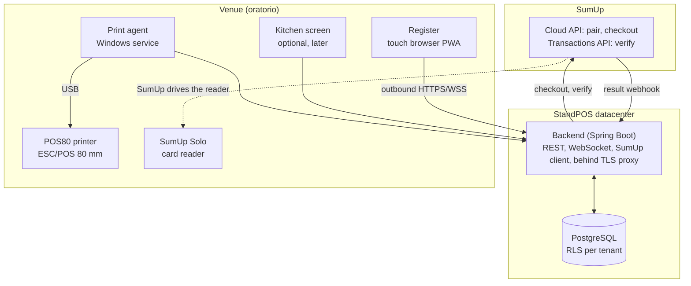
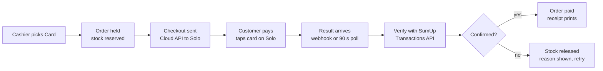
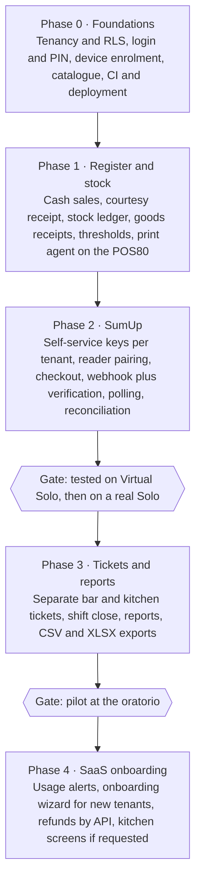

# StandPOS — Technical Specification

Version of 26 October 2026 · Author: Fabiano Moda · Live document: https://claude.ai/artifact/Fvezj345o9HvNGaWViRSk3

This file is the repository copy of the specification and the source of truth for development. Changes are made here through pull requests.

## Overview

StandPOS (working title) is a hosted, multi-tenant point of sale for associations, parish youth centres and food stands that issue non-fiscal courtesy receipts. It combines a touch cash register, per-product stock with goods receipts, order tickets for kitchen and bar, and card payments on a SumUp Solo reader driven directly by the register.

**Goals (v1)**

- One tenant per organisation, each with one or more venues: a bar open all year, a three-day food festival.
- A touch-first register that volunteers can run after five minutes of training.
- Stock per product: goods receipts, low-stock thresholds, automatic sold-out, returns and waste.
- A non-fiscal courtesy receipt on the register's 80 mm printer (the oratorio's POS80, on USB); the customer takes it to the bar or kitchen. Optionally, separate bar and kitchen tickets print with it.
- Card payments on SumUp Solo: the register sends the amount and the result comes back without retyping, set up by each tenant alone in SumUp's self-service dashboard.
- End-of-shift close with cash vs card reconciliation, and exports for the treasurer.
- Free for non-profits, up to 2,000 sales per organisation per month.

**Non-goals (v1)**

- Fiscal documents: no electronic receipt (documento commerciale), no telematic register.
- Selling offline: every venue has Wi-Fi or a 4G/5G connection.
- Anything that needs SumUp to approve or configure the integration: OAuth restricted scopes, partner agreements.
- Online pre-orders, table service from waiter phones, recipes and bill of materials.
- Paid add-ons, set menus, cover charge, takeaway fee, vouchers, staff meals.
- Accounting, invoicing, volunteer management, paid plans and billing.

## Constraints and assumptions

The design rests on eight assumptions; if one is wrong, the affected section changes.

- **Non-fiscal only.** Every receipt is a courtesy receipt with the fixed line "Scontrino di cortesia – documento non fiscale", which tenants cannot edit or remove. Each tenant confirms at onboarding that it has no obligation to issue fiscal documents; the platform does not judge this. A parish bar open all year is often a commercial activity, so the onboarding text points tenants to their accountant.
- **Internet always available.** Every venue has Wi-Fi or a 4G/5G connection, so the platform does not sell offline. The Solo reader uses Wi-Fi by default; its mobile data must be enabled by SumUp, so it is not relied on.
- **No SumUp intervention.** Everything a tenant needs (API key, affiliate key, reader pairing) is created self-service in the SumUp dashboard, following SumUp's public documentation. No OAuth restricted scopes, no partner agreement.
- **Oratorio hardware.** A touchscreen PC with Windows 10 runs the register in a browser; a POS80 thermal printer (80 mm, ESC/POS) is attached by USB. Windows 10 is out of Microsoft support since October 2025: keep that PC isolated on the network.
- **Card reader.** SumUp Solo is the target reader. SumUp Go has its own Cloud API variant, with results by polling, that could be added later; Air, 3G and the all-in-one Terminal are not supported.
- **Money flows to the tenant.** Each tenant uses its own SumUp merchant account; the platform never holds funds.
- **Design load.** Per venue up to 10 registers and about 2,000 orders on a peak day; this is a sizing target, not a measured figure.
- **Clients.** Chromium-based browsers on Windows, Android and iPad. Italian UI first, built for translation.

## Architecture

One Spring Boot backend serves every tenant; at the venue there are only browsers, a print agent and the Solo reader, and all of them connect outward, so no port is ever opened on the venue's router.

The register never calls SumUp directly: the backend starts each checkout and receives the result, so API keys stay on the server and one code path handles every payment.

## Multi-tenancy, roles and security

All tenants share one PostgreSQL database; every row carries `tenant_id`, enforced twice: by a Hibernate filter in the application and by PostgreSQL Row-Level Security as a backstop. Schema-per-tenant was rejected: it multiplies migrations and buys no isolation that RLS does not already give at this scale. The few reads needed before the tenant is known (login by email, device token, enrolment code) go through narrow database functions rather than around RLS ([ADR 0003](adr/0003-pre-tenant-lookups.md)).

**Hierarchy.** Tenant → Venue ("Bar oratorio", "Sagra 2027") → Area ("Cucina", "Bar") → Station (register, kitchen screen, print agent). Keeping commercial and institutional activities in separate venues keeps their revenues apart in reports.

**Roles**, assigned per venue:

| Role | Can |
| --- | --- |
| Platform admin | Manage tenants, support access (audited) |
| Owner | Everything in the tenant, SumUp connection, users |
| Manager | Catalogue, prices, stock, voids, reports |
| Stock clerk | Goods receipts, counts, adjustments |
| Cashier | Sell, take payments, open and close own shift |
| Kitchen | Kitchen screen only |

The owner role covers the whole tenant (every venue); the other tenant roles are held on one venue. Platform admin is a property of the person, not a role inside a tenant ([ADR 0004](adr/0004-roles-and-memberships.md)).

**Authentication.** Owners and managers log in with email and password (Argon2id) plus optional TOTP. Cashiers log in with a 4–6 digit PIN, but only on a device already enrolled for that venue: they tap their name, then type the PIN. Five wrong passwords lock the account, and five wrong PINs lock the PIN, for 15 minutes; an owner, or the venue's manager for a PIN, can unlock earlier. Sessions use HttpOnly, SameSite cookies backed by Spring Session JDBC and last 12 hours.

**Device enrolment.** Each register, kitchen screen and print agent is enrolled once with a one-time code generated by a manager. It receives a device token scoped to venue and role, stored hashed server-side and revocable at any time: browsers keep it in an HttpOnly cookie, the print agent receives it once in the response of its own enrolment endpoint and sends it as a bearer token ([ADR 0005](adr/0005-device-tokens-and-cashier-pin.md)).

**Secrets.** SumUp API keys and affiliate keys are encrypted at rest with AES-256-GCM, key held outside the database (environment or Vault). They never reach the browser.

**Audit log.** Price changes, stock adjustments, voids, refunds, drawer openings without a sale and role changes are recorded with user, device and timestamp.

**Personal data.** Only staff accounts; no customer data is collected. Hosting in the EU (Italy), with a data processing agreement template for tenants.

**Plans and usage limits.** v1 has one plan, free for non-profits, capped at 2,000 sales per organisation per calendar month, counted whether or not a receipt is printed so the no-receipt option cannot bypass it. A counter is incremented inside the sale transaction, so it is exact under load. At 80% of the cap the owner sees a banner and gets an email. At 100% the registers keep selling until the venue's day change, so no event stops mid-service; after that, new sales are blocked until the next month or until the platform admin raises the tenant's cap. Caps live on the plan with a per-tenant override, so a paid plan can be added later without schema changes.

## Data model

Money is stored as integer cents; order lines snapshot name and price so later catalogue edits never rewrite history. Every table below also has `tenant_id`, `created_at` and `updated_at`.

| Entity | Key fields | Notes |
| --- | --- | --- |
| `tenant` | name, status, plan, cap override | One per organisation |
| `plan` | name, sales per month (2,000) | v1: one free plan |
| `usage_counter` | tenant, month, sales, warned at | Incremented in the sale transaction |
| `venue` | tenant, name, kind (permanent, event), receipt header and footer, ticket mode, day change time | Unit of stock and reporting |
| `area` | venue, name | Optional grouping of stations |
| `app_user`, `membership` | email, password hash, PIN hash; user, venue (none for owner), role | A user can hold different roles per venue; users are shared across tenants |
| `device` | venue, kind (register, kitchen, print agent), name, token hash, last seen | Enrolled with a one-time code |
| `route` | venue, name (Cucina, Bar), ticket printer | Which ticket a line goes on |
| `printer` | venue, print agent, Windows printer name, width 80 mm, code page | v1: the register's USB POS80 |
| `category` | venue, name, colour, sort, default route | Buttons on the register |
| `product` | category, name, price, route override, track stock, low threshold, sold-out flag, active | Sold-out set automatically or by hand; once orders or stock movements reference it, deactivated instead of deleted |
| `stock_level` | venue, product, on hand | Materialised from the ledger, updated in the same transaction |
| `stock_movement` | venue, product, quantity (+/−), type, reference, user, note | Ledger; never updated or deleted |
| `supplier` | name, contacts | Tenant-wide |
| `goods_receipt`, `goods_receipt_line` | venue, supplier, document ref, received at; product, quantity, unit cost | Creates `receipt` movements |
| `shift` | station, cashier, opened at, opening float, closed at, counted cash | Cash drawer session |
| `customer_order` | venue, station, shift, daily number, status, total, receipt printed, client UUID | Client UUID makes retries idempotent |
| `order_line` | order, product, name and price snapshot, quantity, route, note | Snapshot keeps history stable |
| `payment` | order, method, amount, status, reader, client transaction id, transaction code, failure reason | Methods: cash, SumUp card, manual card |
| `sumup_connection` | tenant, merchant code, encrypted API key, app id, encrypted affiliate key, status, last check | One per tenant, entered by the owner |
| `sumup_reader` | venue, SumUp reader id, name, assigned station, status | Paired Solo readers |
| `print_job` | venue, printer, kind (receipt, ticket, report), document, status, attempts | Queue mirrored on the agent |
| `audit_log` | user, device, action, entity, before/after | Append-only |

Stock movement types: `receipt`, `sale`, `sale_reversal`, `return_to_stock`, `waste`, `adjustment`, `count`. Order statuses: `awaiting_payment`, `paid`, `cancelled`, `voided`.

## Point of sale flow

A sale is one database transaction that writes the order, its lines and the stock movements together; printing happens only once the order is paid.

1. **Build the cart.** Product buttons grouped by coloured category; sold-out items greyed and untappable; low-stock items show the remaining quantity. Quantity, line note ("senza cipolla"), line delete.
2. **Choose payment.**
   - *Cash*: amount tendered → change shown → drawer opens through the printer's kick pulse.
   - *SumUp card*: amount sent to the Solo assigned to this register (see SumUp section).
   - *Manual card*: fallback when the Solo cannot be reached; recorded but not verified.
3. **Commit.** The client sends the cart with a UUID it generated; a retry with the same UUID returns the same order instead of creating a second one. The server checks the tenant's usage cap, locks the stock rows of the products involved (`SELECT … FOR UPDATE`, ordered by product id to avoid deadlocks), rejects the sale if a tracked product would go below zero, writes `sale` movements and flips sold-out flags.
   - Cash: order goes straight to `paid`.
   - SumUp: order waits in `awaiting_payment` with its stock already held; a failed or cancelled payment reverses it with `sale_reversal` movements.
4. **Print.** The courtesy receipt prints at the register with the daily order number (per venue, reset at the venue's day change) printed large. The customer takes it to the bar or kitchen. If the venue enables separate tickets, one bar ticket and one kitchen ticket print right after it, each cut separately (see next section). A "Senza scontrino" button completes the sale, the payment (cash or SumUp) and the stock movements without printing anything; the receipt can still be printed later from the order list.
5. **Void.** Requires a manager PIN. The manager chooses for each line whether goods go back to stock or to waste. A card payment is refunded in the SumUp app in v1, through the API in a later phase.

Target response time from "Conferma" to receipt printing on cash sales: under one second on a normal connection.

## Inventory

Stock is an append-only ledger of movements per product and venue, with the current quantity materialised in `stock_level` inside the same transaction, so the register never computes a sum at checkout.

- **Tracked or not.** Each product has a `track stock` flag: bottled drinks and portions yes, coffee from the machine no.
- **Goods receipts.** Header (supplier, document number, date) and lines (product, quantity, optional unit cost). Posting creates `receipt` movements. Unit costs feed a weighted average cost per product, used for stock valuation and margin reports.
- **Thresholds and sold-out.** Below the product's low threshold, the register shows the remaining count and managers see an alert. At zero the product turns sold-out on every register at once; a manager can also toggle sold-out by hand ("finite le lasagne").
- **Counts.** A stock count session lists products; the counted quantity is entered and the system writes a `count` movement for the difference, with the user and time.
- **Adjustments.** Breakage, gifts, staff meals: an `adjustment` or `waste` movement with a mandatory reason.
- **Returns and waste.** On void, each line goes `return_to_stock` or `waste`; the end-of-event report shows the two separately.
- **Negative stock.** Not allowed by default; a venue setting allows it for events where receipts are posted after the fact.

Out of scope for v1: recipes and bill of materials (one panino = bread + sausage), transfers between venues, lots and expiry dates.

## Printing and ticket modes

Everything prints on the register's own USB printer. A browser cannot print silently in raw ESC/POS, so a small print agent runs as a service on the register PC.

**Ticket modes**, chosen per venue:

- *Receipt only* (default, the oratorio today): one courtesy receipt; the customer shows it at the bar or kitchen.
- *Receipt plus tickets*: after the receipt, one ticket for each route that has lines in the order (Bar, Cucina), each cut separately; the customer hands each ticket to the right counter. Products reach a route through their category, with a per-product override.
- *Remote printers* (later): a route's ticket prints on a printer at the counter, through a print agent there. The data model already allows it.

**Print agent.**

- Java Windows service, installed once on each register PC.
- Connects out to the server over `wss://` with its device token: no inbound ports, works behind any router.
- Prints raw ESC/POS to the USB POS80 through the Windows spooler (printer by name), using the escpos-coffee library: code page with the € sign, large order number, logo bitmap, paper cut, drawer kick. A LAN printer on TCP 9100 works the same way if one is added.
- Keeps its own job queue in a local SQLite file, so jobs survive a reboot; acknowledges each job as printed or failed; retries with backoff; a heartbeat every 15 s lets the register show "stampante offline".
- The server sends a structured document (lines, styles, cut), not bytes: the layout lives in one place.
- Considered alternative: Chrome in kiosk mode with silent printing through the Windows driver. No install, but cut, drawer kick and layout are harder to control; kept as a fallback where a service cannot be installed.

**Content.** Receipt: venue header, order number (large), time, register, lines with prices, total, payment method, the fixed "Scontrino di cortesia – documento non fiscale" line. Bar or kitchen ticket: order number (large), time, only that route's lines and notes, no prices.

**Kitchen screen (later, optional).** A browser page filtered by route that shows tickets live over WebSocket, for venues that prefer screens to paper. The oratorio's receipt-only flow does not need it.

## SumUp Solo integration

The register never talks to SumUp: the server sends the amount to the tenant's Solo through the SumUp Cloud API and marks the order paid only after it has confirmed the transaction with SumUp itself.

A failed, cancelled or unconfirmed payment always ends with the stock released and SumUp's reason shown to the cashier.

**Authorisation without SumUp's involvement.** OAuth would let tenants connect with one click, but its `payments` scope is restricted and verified manually by SumUp, which this project rules out. Each tenant instead connects its own account with self-service credentials:

- *API key*: created by the owner in the SumUp dashboard, pasted into StandPOS, stored encrypted. SumUp states an API key is enough when access is not delegated to third parties.
- *Affiliate key and application identifier*: created by the same owner under Settings → For Developers → Toolkit → Affiliate Keys. SumUp requires an affiliate key in every Cloud API checkout and describes it as unique to each account and mandatory for every merchant, so each tenant uses its own.
- An onboarding wizard walks the owner through both with screenshots, then checks the keys by listing the account's readers before saving.
- Trade-off: tenants hold and rotate their own secrets, and a platform storing tenants' API keys sits closer to the delegated access SumUp associates with OAuth. Accepted as a known risk; a revoked key shows up in the wizard's check and on the register before the first card payment.

**Pairing a reader.** A guided page for the owner: log out of the Solo, open Connections → API → Connect, type the 8–9 character code shown on the reader within 5 minutes, name the reader ("Solo cassa 1") and assign it to a register.

**Checkout.** The server calls `POST /v0.1/merchants/{merchant}/readers/{reader}/checkout` with the amount in cents, a description ("Ordine 123"), the affiliate data and a `return_url` of the form `https://<host>/webhooks/sumup/{tenant}/{one-time token}`. It stores the returned `client_transaction_id` on the payment. SumUp's documented constraints shape the register UI:

- The reader must be online, or the checkout is refused.
- Once accepted, the reader has 60 s to start the payment, and any other checkout for that reader is rejected meanwhile: one reader per register.
- The cashier can cancel only while the reader waits for the card or PIN; there is no confirmation, and a cancelled payment arrives as `failed`.

**Result.** SumUp posts a `solo.transaction.updated` event to the `return_url` with status `successful` or `failed` and, when failed, a free-text `failure_reason` that is shown to the cashier but never parsed. The payload carries no documented signature, so the webhook is treated as a hint:

1. Accept only on a matching one-time token, then look up the transaction through the Transactions API by `client_transaction_id` (default `transactions.history` scope).
2. Mark paid only if SumUp reports it successful for the same amount; store the transaction code.
3. Process idempotently: `client_transaction_id` is unique, and a duplicate event is a no-op.
4. If no event arrives within 90 s, poll the same lookup; the register keeps showing "In attesa…" with a cancel button.

**Register states.** Inviato al lettore → In attesa della carta → Pagato (receipt prints) or Rifiutato (reason, retry, other method).

**Testing.** SumUp offers a Virtual Solo with sandbox merchant accounts, so pairing and checkout are built and tested without hardware; the physical Solo is needed only to validate device behaviour. Fees are charged by SumUp to each tenant's merchant account.

## Connectivity loss and resilience

Every venue has Wi-Fi or 4G/5G, so there is no offline selling; resilience work goes into the failures that remain likely.

| Failure | Behaviour |
| --- | --- |
| Venue internet down | Red banner on every register; sales blocked until the connection returns |
| SumUp API or reader unreachable | Register offers cash or manual card; manual card payments are flagged for reconciliation |
| Print agent offline | Jobs stay queued on the server; register warns; jobs print when the agent reconnects |
| Printer out of paper or jammed | Agent reports the error; the cashier fixes it and presses "Ristampa" |
| Usage cap reached | Selling continues until the day change, then is blocked (see Multi-tenancy) |

**Card fallback, to test on a real reader.** To be driven by StandPOS, a Solo is logged out of the SumUp account. If SumUp's servers are unreachable while the venue's internet works, it is unclear whether that Solo can still take a payment on its own, or whether a phone with the SumUp app (Tap to Pay) is the practical fallback. A short test on a real reader settles it.

## Reporting and end-of-shift close

Every shift closes with a printed and stored summary that tells the cashier exactly how much cash must be in the drawer.

**Shift close** (printable on the POS80, stored as PDF):

- Opening float, cash sales, change given, expected cash; counted cash entered by the cashier; difference.
- SumUp card payments (confirmed with SumUp), manual card payments.
- Voids and returns, each with the manager who approved it.

**Manager reports** (screen, CSV and XLSX export):

- Sales by product, category, route, hour and day; per venue and per event.
- Stock: on hand, below threshold, receipts posted, waste, valuation at average cost, margin per product.
- SumUp reconciliation: the day's SumUp transactions from the Transactions API against StandPOS payments, listing any transaction without an order or order without a transaction.
- End-of-event statement for the treasurer: revenue by method, stock consumed, waste, remaining stock, cost of goods received.

## Deployment and operations

The platform runs as a Docker Compose stack in the ISO 27001 datacenter, behind a public HTTPS endpoint, which SumUp needs to deliver payment results.

| Component | Technology |
| --- | --- |
| Backend | Java 25, Spring Boot 4.x, Spring Security, Spring Data JPA, Flyway, WebSocket/STOMP |
| Database | PostgreSQL 17 with Row-Level Security; WAL archiving plus nightly `pg_dump` |
| Frontend | React + TypeScript (Vite), installable PWA, touch-first; Italian strings in i18n files |
| Print agent | Java 25, escpos-coffee, SQLite queue; packaged with jpackage and run as a Windows service |
| Edge | Reverse proxy with automatic TLS (Caddy), rate limits on login and webhooks |
| Observability | Structured JSON logs, Micrometer metrics, uptime checks on the webhook endpoint |

**Environments.** Development and staging use a SumUp sandbox merchant and the Virtual Solo; production uses real merchant accounts.

**Demo environment.** The demo runs on an Oracle Cloud Always Free Ampere A1 VM (Arm, up to 4 OCPU and 24 GB RAM in total), with the same Docker Compose stack as production built for `arm64`. It uses only the SumUp sandbox and the Virtual Solo, never real merchant keys or customer money. Production stays in the ISO 27001 datacenter.

- Home region chosen once at sign-up and in the EU; Always Free block storage must live there.
- Ports 80 and 443 opened both in the OCI security list and in the VM's own firewall; a DNS name points to the VM so the reverse proxy obtains a TLS certificate and SumUp can reach the webhook.
- Idle Always Free instances can be reclaimed after 7 days of low CPU, network and memory use, which is exactly what a demo looks like between sessions. Upgrading the account to Pay As You Go, with a budget alert, keeps Always Free resources at no cost and is the usual way to avoid it; to confirm against Oracle's current terms before the demo goes live.
- Nightly `pg_dump` to OCI Object Storage, so a lost VM is rebuilt from Compose and the last dump.

**Backups.** Continuous WAL archiving plus nightly dumps kept 30 days; a restore drill before the first live event.

**CI.** Build, unit and integration tests (Testcontainers with PostgreSQL), container images for `amd64` and `arm64`, Flyway migration check.

**Documentation shipped with the code.** README, CHANGELOG, installation guide, print agent setup guide, SumUp pairing guide, cashier quick guide and manager guide, all as Markdown in the repository.

## Delivery plan

Work is cut so each phase ends with something usable at the oratorio; the pilot starts after Phase 3, and features needed only for other tenants wait until it has run.

Each phase ships with its Markdown documentation updated. Durations are not estimated yet; with offline mode and OAuth out of scope, the main remaining unknown is the print agent on the real POS80.

## Decisions and open questions

Ten scope decisions were taken on 22 October 2026 and four more on 26 October 2026, after Phase 0; two points remain open, and none of them blocks Phase 1.

| Topic | Decision |
| --- | --- |
| Offline selling | Not built: every venue has Wi-Fi or 4G/5G |
| SumUp setup | Self-service only, from public documentation; no OAuth, no SumUp approval |
| Receipt type | Always a non-fiscal courtesy receipt, fixed wording |
| Sale without receipt | Allowed per sale ("Senza scontrino"): payment and stock recorded, nothing printed |
| Printer at the oratorio | POS80 on USB at the register |
| Register PC | Windows 10 |
| Ticket flow | Receipt only by default; receipt plus separate bar and kitchen tickets as a venue option |
| Commercial model | Free for non-profits, up to 2,000 sales per organisation per month |
| Add-ons, set menus, cover charge, takeaway fee, vouchers, staff meals | Out of scope |
| Name | StandPOS for now |
| Product deletion | Deleted only while unused; once orders or stock movements reference it, deactivated |
| Session length | 12 hours for managers and cashiers |
| Lockout | 15 minutes after five failures; owners, and venue managers for PINs, can unlock earlier |
| Print agent enrolment | Own endpoint, token in the response body, no cookie and therefore no CSRF token |

- [ ] Card fallback when SumUp is unreachable: short test on a real Solo (see Connectivity).
- [ ] Tenant-supplied API keys vs SumUp's OAuth recommendation for platforms: accepted risk, to revisit if SumUp changes its terms.

## Sources

- [SumUp Cloud API for Solo](https://developer.sumup.com/terminal-payments/cloud-api)
- [SumUp Affiliate Keys](https://developer.sumup.com/tools/authorization/affiliate-keys/)
- [SumUp OAuth 2.0 and scopes](https://developer.sumup.com/tools/authorization/oauth)
- [SumUp Transactions API](https://developer.sumup.com/api/transactions)
- [SumUp Cloud API for SumUp Go](https://developer.sumup.com/terminal-payments/cloud-api/go/)
- [Oracle Cloud Always Free resources](https://docs.oracle.com/en-us/iaas/Content/FreeTier/resourceref.htm)
